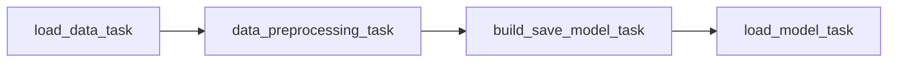
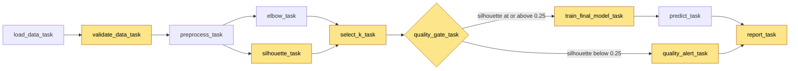
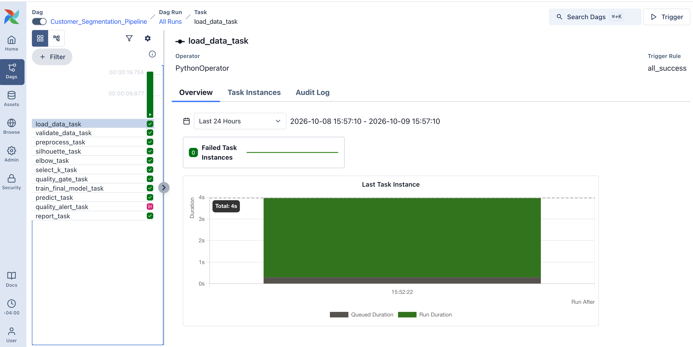

# IE7374 Lab Assignment 3: Airflow Customer Segmentation Pipeline

[](https://github.com/lequo-neu/IE7374-Airflow-Assignment3/actions/workflows/unit_tests.yml)

An Apache Airflow pipeline, running in Docker, that segments credit card
customers with KMeans. Before training anything, it checks that the data is fit
to use. It picks the number of clusters with two methods that run in parallel,
lets a quality gate decide whether the new model is good enough to keep, and
writes a JSON report at the end of every run, whichever way the gate went.

## At a Glance

| What to check | Answer |
|---|---|
| Based on | Airflow_Labs/Lab_1 from the course repository |
| Core concept changed | The DAG itself: from 4 tasks in a straight line to 11 tasks with a parallel fan out, a branch, and a join. See [Changes Made to the Lab](#changes-made-to-the-lab) |
| Advanced extension | Parallel model selection with a branching quality gate. See [Advanced Extension](#advanced-extension-parallel-model-selection-with-a-branching-quality-gate) |
| Bugs fixed from the original | 2, both in how the model was saved and used. See [Two Bugs Fixed](#two-bugs-fixed-from-the-original-lab) |
| Proof that it works | The grid view below, the run report, and 13 unit tests shown by the badge above. See [What a Successful Run Looks Like](#what-a-successful-run-looks-like) |
| Run it yourself | One setup script and three Docker commands. See [Running the Code](#running-the-code) |

## The DAG, Before and After

**Original Lab_1**



**This version**

Yellow tasks are new. The quality gate sends each run down exactly one of the
two branches, and the report task joins them again.





In the grid view of a real run, every task is green except quality_alert_task,
which is marked skipped because the gate chose the training branch.

## Changes Made to the Lab

| Area | Original Lab_1 | This version |
|---|---|---|
| DAG shape | 4 tasks in a straight line | 11 tasks: parallel fan out, a fan in, a branch, and a join |
| Data checks | None | Validation task stops the run on missing columns, fewer than 1,000 rows, or more than 5% nulls |
| Choosing k | Elbow only, printed and then ignored | Elbow and silhouette in parallel, combined by an explicit rule |
| Deciding whether to keep the model | Never, the model is always saved | Branching quality gate on the silhouette score |
| Saved model | The last model in the loop, always k=49 | A fresh model trained with the chosen k, saved with its scaler |
| Prediction | First test row only, on unscaled data | Every test row, with the same transformation used in training |
| Run record | None | JSON report on every run, from either branch |
| Retries | 0 | 1, after one minute |
| Features | 3 columns, min max scaled | 5 columns, log transformed then standardized |
| Tests | None | 13 unit tests, run in CI on every push |

### Tasks

| Task | Type | What it does | Runs when |
|---|---|---|---|
| load_data_task | Python | Reads the 8,950 customer rows | Always |
| validate_data_task | Python | Checks columns, row count and null share, fails the run if they are off | After load |
| preprocess_task | Python | Selects 5 features, drops nulls, log transforms and standardizes | After validation passes |
| elbow_task | Python | Fits KMeans for k from 2 to 15 and finds the elbow of the error curve | In parallel with silhouette_task |
| silhouette_task | Python | Scores every k from 2 to 15 for how well separated the clusters are | In parallel with elbow_task |
| select_k_task | Python | Combines both results into one chosen k and records why | After both selection tasks |
| quality_gate_task | Branch | Returns the next task: training if silhouette is at or above 0.25, alert if not | After select_k |
| train_final_model_task | Python | Trains KMeans with the chosen k and saves it with its scaler | Gate passed |
| quality_alert_task | Python | Logs a warning and keeps the previous model | Gate failed |
| predict_task | Python | Assigns the new customers in test.csv to clusters | After training |
| report_task | Python | Collects every result into dags/reports | Either branch, trigger rule none_failed_min_one_success |

### How the code is organised

All task logic lives in dags/src/pipeline.py, which has no Airflow imports. The
DAG file only wires tasks together. This split means every function can be unit
tested with plain pytest, without starting Airflow, and the 13 tests run on
GitHub Actions on every push. Data moves between tasks through XCom as base64
encoded pickles, the same technique the original lab uses.

The feature set grew from three columns to five: BALANCE, PURCHASES,
CASH_ADVANCE, CREDIT_LIMIT and PAYMENTS. These amounts are heavily right skewed,
so they are log transformed and standardized instead of min max scaled, which
keeps a few very large accounts from dominating the distance calculation. Nulls
are dropped only in the selected features rather than across all eighteen
columns, which keeps more rows.

### Two Bugs Fixed from the Original Lab

| Bug in the original | Effect | Fix |
|---|---|---|
| The model saved after the loop was the last one fitted | The saved model always had 49 clusters, whatever the elbow method recommended | A separate task retrains with the chosen k and saves that model |
| Training used scaled data but prediction used the raw test file | Predictions were made on numbers in a completely different range from the ones the model learned on | The fitted scaler is saved in the same bundle as the model and applied before predicting |

## Advanced Extension: Parallel Model Selection with a Branching Quality Gate

**Why this was chosen**

The original DAG trains a model, prints a recommendation, and stops. Nothing in
the workflow decides anything, so a poor clustering would be saved and used just
as readily as a good one. That is the gap between a script that happens to run on
a schedule and a pipeline that can be trusted to run unattended. In a real
segmentation system, a model that splits customers into meaningless groups is
worse than keeping last week's model, because other teams act on the segments.

The elbow method on its own is also a weak basis for that decision. It looks only
at how much error drops as k grows and says nothing about whether the clusters
are actually well separated. Silhouette measures exactly that, but it can favour
very small k. Using both gives a sturdier answer than either alone, and since
they do not depend on each other, Airflow can run them side by side.

**How it works**

| Step | Rule | Result |
|---|---|---|
| Select k | Silhouette at the elbow k is within 0.05 of the best silhouette | Keep the elbow k |
| Select k | Otherwise | Switch to the k with the best silhouette |
| Quality gate | Silhouette at the chosen k is at least 0.25 | Train, save, predict, report with status model_updated |
| Quality gate | Silhouette below 0.25 | Alert, keep the previous model, report with status model_rejected |

After preprocessing, elbow_task and silhouette_task start at the same time from
the same input. select_k_task waits for both and records which rule it applied.
quality_gate_task returns the id of the next task, and Airflow marks the branch
that was not chosen as skipped. The report task still runs at the end, because
its trigger rule only requires that nothing failed and that at least one
upstream task succeeded.

**What it produces**

Every run leaves a readable record in dags/reports: the validation summary, the
k each method suggested, the k chosen and why, the silhouette score the gate
judged, the size of every cluster, the predicted clusters for new customers, and
a final status. In this run both methods agreed on six clusters, the silhouette
of 0.3205 cleared the 0.25 gate, and the model was updated.

## Prerequisites

Docker Desktop, with at least 4 GB of memory allocated to Docker (8 GB is
recommended). Download from https://www.docker.com/products/docker-desktop and
verify with: docker --version

Git. Download from https://git-scm.com and verify with: git --version

Python 3.10 or later, only needed to run the unit tests outside Docker. Verify
with: python3 --version

The Airflow image is apache/airflow:3.3.2, pinned as the default in
docker-compose.yaml. The setup script tells the containers to install
scikit-learn and kneed when they start, so nothing has to be installed inside
Docker by hand.

## Environment Setup

Clone the repository.

```
git clone https://github.com/lequo-neu/IE7374-Airflow-Assignment3.git
cd IE7374-Airflow-Assignment3
```

Run the setup script once. It creates the folders Airflow mounts and writes a
.env file with your user id and the extra Python packages.

```
bash setup.sh
```

Initialize the Airflow database. The first run downloads the images and can take
a few minutes.

```
docker compose up airflow-init
```

## Running the Code

**Optional: run the unit tests first, without Docker**

```
python3 -m venv venv
source venv/bin/activate
pip install -r requirements.txt
pytest -v
```

**Start Airflow and trigger the DAG**

Start all services in the background, wait about a minute, then check that they
report healthy.

```
docker compose up -d
docker compose ps
```

Open http://localhost:8080 in a browser and log in with username airflow and
password airflow. Find Customer_Segmentation_Pipeline in the Dags list, switch it
on with the toggle, and click Trigger.

When the run finishes, check the outputs on your machine.

```
ls dags/model dags/reports
cat dags/reports/*.json
```

Stop everything when you are done.

```
docker compose down
```

If port 8080 is already in use by another program, change the host port and
open http://localhost:8081 instead.

```
sed -i '' 's/"8080:8080"/"8081:8080"/' docker-compose.yaml
```

Warnings about FERNET_KEY not being set are expected with the default compose
file and can be ignored for local use.

## What a Successful Run Looks Like

| Check | Result |
|---|---|
| Unit tests | 13 passed |
| DAG run | All 11 tasks finished in about 20 seconds, quality_alert_task skipped |
| Rows validated | 8,950, with at most 0.01% nulls in any feature |
| k chosen | 6, agreed by both elbow and silhouette |
| Silhouette at k = 6 | 0.3205, above the 0.25 gate |
| Outcome | Model updated, 3 new customers assigned to clusters 4, 0 and 2 |

The unit tests end with this line.

```
13 passed in 13.33s
```

The task logs show both methods agreeing on six clusters, and the gate passing.

```
Elbow method suggests k = 6
Silhouette method suggests k = 6 (score 0.3205)
Quality gate PASSED: 0.3205 >= 0.25
```

The report written to dags/reports looks like this.

```json
{
  "run_id": "manual__2026-10-09T19:52:22.393811+00:00",
  "validation": {
    "rows": 8950,
    "null_ratio": {
      "BALANCE": 0.0,
      "PAYMENTS": 0.0,
      "PURCHASES": 0.0,
      "CASH_ADVANCE": 0.0,
      "CREDIT_LIMIT": 0.0001
    }
  },
  "selection": {
    "reason": "elbow k kept (silhouette within tolerance)",
    "k_elbow": 6,
    "chosen_k": 6,
    "silhouette": 0.3205,
    "k_silhouette": 6
  },
  "final_model": {
    "k": 6,
    "model_path": "/opt/airflow/dags/model/kmeans_bundle.pkl",
    "cluster_sizes": {
      "0": 1941,
      "1": 251,
      "2": 1824,
      "3": 1600,
      "4": 1587,
      "5": 1746
    }
  },
  "predictions": [4, 0, 2],
  "alert": null,
  "status": "model_updated"
}
```

The three predictions are the cluster assignments for the three new customers in
dags/data/test.csv. The saved model bundle appears at dags/model/kmeans_bundle.pkl.

## Project Structure

```
IE7374-Airflow-Assignment3/
    .github/
        workflows/
            unit_tests.yml              (runs the 13 unit tests on every push)
    assets/
        dag_grid_view.png
    dags/
        customer_segmentation_dag.py    (DAG: validation, parallel selection, branching, report)
        data/
            file.csv                    (credit card customers from the original lab)
            test.csv                    (three new customers to segment)
        src/
            __init__.py
            pipeline.py                 (all task logic, no Airflow imports)
    test/
        test_pipeline.py                (13 unit tests)
    docker-compose.yaml                 (official Airflow 3.3.2 compose, example DAGs turned off)
    setup.sh                            (creates folders and .env)
    pytest.ini
    requirements.txt
    .gitignore
    README.md
```

Folders created at runtime, such as logs, config, plugins, dags/model and
dags/reports, are excluded from version control.
